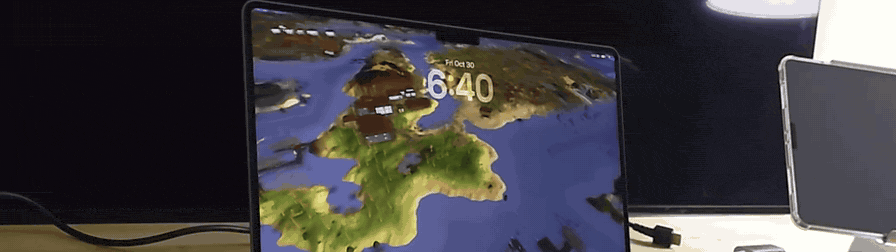

# RuneScape World — macOS screen saver

Your Mac unlocks to a slow, silent flight over Gielinor instead of a stock
aquarium.

The saver hosts the real RuneScape map viewer
([dennisdev/rs-map-viewer](https://github.com/dennisdev/rs-map-viewer), the engine
behind <https://osrs.world>) in a `WKWebView` and drives it with an "ambient"
camera: pick one of ~75 hand-picked zones, fly there (or cross-fade if it is far
away), hold an `orbit` / `pan` / `drift` / `push` move for a while — or follow a
wandering NPC — then move on. Every few zones it swaps the modern cache for the
February 2005 one, so the same tour occasionally plays out on the game world as it
looked back then.

It renders the actual Jagex cache with the upstream WebGL2 engine (workers, WASM,
`CacheStorage`), capped at 30 fps.

## Install

### Prebuilt (no build tools)

```sh
curl -fsSL https://raw.githubusercontent.com/torytyler/osrs-map-screensaver/main/install.sh \
  | bash -s -- --binary
```

Downloads the signed (ad-hoc) `.saver` plus a `python3`-only cache fetcher, and
pulls the RuneScape caches (~250 MB, one time) into
`~/Library/Application Support/OSRSMapSaver/caches`.

### From source

Needs Node.js 18+ and the Xcode Command Line Tools.

```sh
git clone https://github.com/torytyler/osrs-map-screensaver.git
cd osrs-map-screensaver
./install.sh
```

`install.sh` clones the viewer fork, builds the React app, fetches the caches,
compiles the universal (arm64 + x86_64) `.saver` and copies it to
`~/Library/Screen Savers`.

Then: **System Settings → Screen Saver → RuneScape World**. Press **Options…** to
tune it.

## Offline use & cache backups

The screen saver never touches the network: the viewer talks to the bundled HTTP
server, which serves the map data from disk. The only download in the whole
project is the one-time cache fetch during install (archive.openrs2.org, ~250 MB),
into:

```
~/Library/Application Support/OSRSMapSaver/caches
```

Keep a snapshot of it, so a reinstall still works if that archive site is slow,
moves or disappears:

```sh
./scripts/caches-backup.sh create                  # ~/Documents/osrs_map_screensaver-offline/osrs-caches-YYYY-MM-DD.tar.zst
./scripts/caches-backup.sh verify  <archive>       # checksum + contents + revisions
./scripts/caches-backup.sh restore <archive> --force
```

Or reinstall straight from a snapshot — only `tar` and `python3` are needed, and
the caches are never fetched from the internet:

```sh
./install.sh --binary  --offline ~/Documents/osrs_map_screensaver-offline/osrs-caches-2026-10-30.tar.zst
./install.sh --caches  --offline <archive>         # just repair the cache folder
```

The same snapshot is also published here, so a fresh machine does not depend on
OpenRS2 at all:

```sh
./install.sh --caches --caches-mirror     # pulls the archive from the releases page
```

([snapshot release](https://github.com/torytyler/osrs-map-screensaver/releases/tag/caches-2026-10-30),
209 MB, with a `.sha256`.) It is a point-in-time copy — OpenRS2 is still the way
to get *newer* revisions, and the Options sheet lists whatever is installed.

An archive is `caches.json` plus one directory per revision (`osrs-241_2026-10-28`,
`rs2-295_2005-02-21`) holding the raw `main_file_cache.*` files and `keys.json`.
macOS `tar` reads `.tar.zst` natively, so no extra tools are required to restore.

## Options

The standard macOS configure sheet, everything written as clamped values:

| section | controls |
| --- | --- |
| World | which cache to use (any installed revision), era rotation (`current + 2005`, `current only`, `2005 only`), how often the era switches |
| Pacing | scene duration (5–300 s), cross-fade for long jumps |
| Camera | frame rate, render distance, fog band, sky colour, zone caption |
| Motion | how often a scene follows an NPC, the jump-cut distance window |
| Advanced | in-page debug HUD, reset to defaults |

Values are stored per-machine in the screen saver container:

```
~/Library/Containers/com.apple.ScreenSaver.Engine.legacyScreenSaver/Data/Library/Preferences/ByHost/org.osrsmapsaver.saver.<UUID>.plist
```

Pressing OK reloads the viewer in place (about 150 ms — the map data comes from
WebKit's `CacheStorage`).

## Ambient URL parameters

Opt-in, so the normal viewer is untouched — append them to any viewer URL
(`./preview.sh "ambient=1&distance=224&debug=1"`).

| param | default | meaning |
| --- | --- | --- |
| `ambient` | – | `1` enables it; a zone name pins that zone (`?ambient=Lumbridge`) |
| `dwell` | `30` | seconds parked in a scene (timer starts on arrival) |
| `fade` | `1` | cross-fade seconds for long jumps |
| `fps` | `30` | frame cap (`20` in the System Settings preview pane) |
| `distance` | `320` | render distance in tiles (`192` in the preview pane) |
| `fog` | `96` | fog band at the edge of the render distance |
| `sky` | `0x000000` | sky/fog colour |
| `npc` | `0.5` | chance a scene follows a wandering NPC |
| `era` | `mixed` | `latest`, `legacy` (2005 cache) or `mixed` |
| `eraevery` | `4` | zones between era switches |
| `minflight` / `maxflight` | `140` / `950` | distance window where we fly instead of cut |
| `labels` | `1` | zone name caption |
| `debug` | `0` | state/FPS overlay |
| `seed` | random | deterministic zone rotation |
| `lite` | – | low-cost profile (1 worker) |

## How it works

```
ScreenSaverEngine
└── legacyScreenSaver.appex  (sandboxed app extension)
    └── OSRSMapSaver.saver
        ├── ScreenSaverView → WKWebView
        └── HTTPServer (Network.framework, 127.0.0.1:<random>)
              ├── /          → Contents/Resources/web (the React build)
              └── /caches/*  → ~/Library/Application Support/OSRSMapSaver/caches
```

A tiny embedded HTTP server (instead of `file://`) gives the viewer a real origin,
which it needs for workers, WASM, `CacheStorage`, `SharedArrayBuffer` (COOP/COEP)
and HTTP `Range` requests.

The ambient engine lives in the viewer fork under `src/ambient/`:

- `zones.ts` — ~75 hand-picked places with a radius and preferred camera height.
- `scenes.ts` — motion models (`orbit`, `pan`, `drift`, `push`, `npc`) as pure
  functions of time, so nothing drifts; plus the flight path and landing pose.
  Every scene starts exactly on the pose a flight lands on.
- `NpcFinder.ts` — picks a nearby NPC from the loaded map squares and tracks it
  live (NPCs wander and animate in the upstream engine).
- `cameraMath.ts` — RS angle/yaw/pitch conversions and a `PoseSmoother` low-pass,
  so map-streaming hitches and NPC tile steps never show as jitter.
- `AmbientDirector.ts` — the state machine `black → dwell → (flight | fade) → …`,
  scene selection, prefetching along the flight path, era switching.
- `AmbientOverlay.ts` — fade-to-black, zone caption, debug HUD (plain DOM, no
  React re-renders).

## Repository layout

```
macos/Saver/          ScreenSaverView, WKWebView, HTTP server, options sheet
macos/Host/           dev harness app (runs the .saver in a window)
macos/build.sh        builds OSRSMapSaver.saver (+ harness), optional install
scripts/fetch-caches.py   dependency-free cache downloader (python3 stdlib)
scripts/caches-backup.sh  snapshot / verify / restore the caches offline
install.sh            install from source or from the prebuilt release
preview.sh            the same viewer in a browser, for fast iteration
media/                banner.gif / banner.webm / banner.mp4
HANDOFF.md            deep notes: file map, a full list of tunables, gotchas
```

The viewer itself is a separate repository:
[torytyler/rs-map-viewer](https://github.com/torytyler/rs-map-viewer) (fork of
`dennisdev/rs-map-viewer`), which `install.sh` clones into `repo/`.

## Dev loop

```sh
./preview.sh                                   # browser, hot-reloadable
./preview.sh "ambient=1&zone=Varrock%20Square&debug=1"

(cd repo && npm run build)                     # just the web app
macos/build.sh install                         # just the native bundle
macos/build/OSRSMapSaverHarness.app/Contents/MacOS/OSRSMapSaverHarness \
  "$PWD/macos/build/OSRSMapSaver.saver" --quit-after 120
```

The harness takes `--fullscreen`, `--quit-after <s>`, `--hide-after <s>`,
`--cover-after <s>` (reproduces the occlusion bug) and, for the options sheet,
`--show-options`, `--options-edit`, `--options-ok-after <s>`,
`--options-cancel-after <s>`, `--options-screenshot <path>`.

## Troubleshooting

**Black screen, cache loads fine.** On macOS 26+ legacy savers run inside the
sandboxed `legacyScreenSaver` app extension, whose window WebKit classifies as
*occluded* — which silently stops `requestAnimationFrame` and throttles timers.
The saver disables that heuristic (`_setWindowOcclusionDetectionEnabled:`) and the
renderer falls back to a timer loop if rAF ever starves.

**Where are the logs?**

```sh
tail -f ~/Library/Containers/com.apple.ScreenSaver.Engine.legacyScreenSaver/Data/Library/Logs/saver.log
```

Every request, page state, configure-sheet activity and a 5 s heartbeat with
zone/phase/camera. `?debug=1` (or a `debug` file in
`~/Library/Application Support/OSRSMapSaver/`) shows an on-screen state overlay and
enables the Web Inspector.

**Two displays.** Each display gets its own saver view, and each view is a full
WebGL viewer, so rendering both doubles GPU work and heat. When an external
display is present only that one plays and the built-in panel stays black.
`OSRS_SAVER_FORCE_PLAY=1` overrides it (the dev harness sets it).

**Downloaded via a browser?** macOS quarantines the `.saver` and may call it
damaged. `xattr -dr com.apple.quarantine ~/Library/Screen\ Savers/OSRSMapSaver.saver`
(or use `./install.sh --binary`, which curls it instead).

**Wrong RuneScape revision / empty cache list.** `./install.sh --caches` re-downloads
the caches; the Options sheet lists whatever is in `caches.json`. If
archive.openrs2.org is unreachable use `--caches-mirror` (published snapshot) or
`--offline <archive>` (local snapshot).

## Uninstall

```sh
rm -rf ~/Library/Screen\ Savers/OSRSMapSaver.saver
rm -rf ~/Library/Application\ Support/OSRSMapSaver        # caches, ~250 MB
# keep a snapshot first if you might reinstall:
#   ./scripts/caches-backup.sh create
defaults -currentHost delete org.osrsmapsaver.saver 2>/dev/null
```

## Credits

- [dennisdev/rs-map-viewer](https://github.com/dennisdev/rs-map-viewer) (BSD
  2-Clause) — the viewer and WebGL2 renderer this is built on.
- Jagex, RuneLite, the [OpenRS2 archive](https://archive.openrs2.org), 2004scape,
  2009scape and the OSRS Wiki for the data and caches.
- RuneScape content © Jagex Ltd. This project is unofficial and not affiliated
  with Jagex.

BSD 2-Clause — see [LICENSE](LICENSE).
